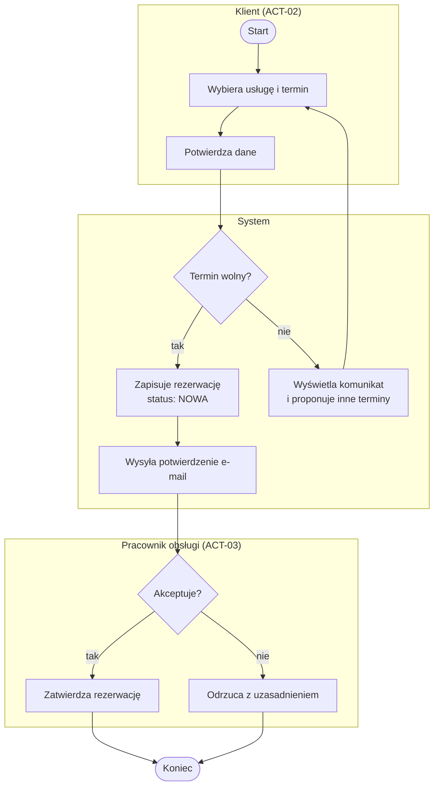
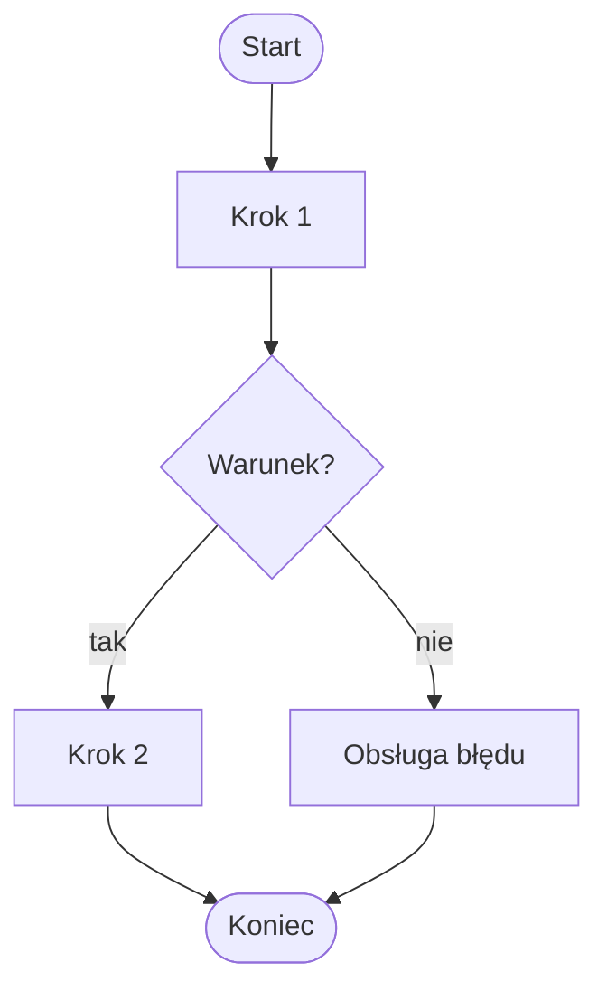

# 2. Specyfikacja Wymagań Systemowych

<!--
Właściciel wiodący: Analityk Biznesowy (FR, procesy) + QA / Tech Writer (NFR, testowalność). Termin: v0.5.
Minimum: ≥ 2 profile aktorów; ≥ 2 diagramy procesów (UML aktywności lub BPMN) ze ścieżkami błędów;
10–15 User Stories z MoSCoW, Given/When/Then dla każdego "Must"; 6–8 mierzalnych NFR z ≥ 4 charakterystyk ISO/IEC 25010.
Typowe błędy: wiele funkcji w jednej US ("…i…i…"); US z perspektywy systemu ("Jako system…");
NFR bez liczby i warunków pomiaru; diagram bez ścieżki błędu; inne nazwy aktorów w diagramie i w tabeli.
-->

## 2.1. Aktorzy systemu (role użytkowników i uprawnienia)

| ID | Aktor | Opis | Kluczowe uprawnienia | Interesariusz |
|---|---|---|---|---|
| ACT-01 | [Gość] | [niezalogowany użytkownik] | [przeglądanie oferty] | INT-02 |
| ACT-02 | [Klient] | [ ] | [ ] | INT-02 |
| ACT-03 | [Pracownik obsługi] | [ ] | [ ] | INT-03 |
| ACT-04 | [Administrator] | [ ] | [zarządzanie kontami i słownikami] | INT-04 |
| ACT-05 | [System zewnętrzny — np. bramka płatności] | aktor systemowy | [ ] | INT-05 |

## 2.2. Modele procesów biznesowych

<!--
Każdy proces: ID, nazwa, wyzwalacz, aktorzy, ścieżka główna (happy path) + ≥ 1 ścieżka błędu/alternatywna.
Tory (swimlanes) w Mermaid: subgraph na aktora. BPMN z innego narzędzia → źródło w docs/diagramy/, SVG w docs/img/.
Wzorce: S08 — atlas diagramów.
-->

### PROC-01: [Nazwa procesu, np. Rezerwacja terminu]

**Wyzwalacz:** [ ] · **Aktorzy:** ACT-02, ACT-03 · **Powiązane wymagania:** FR-01, FR-02, FR-03

**Opis:** [1–3 zdania: co pokazuje diagram, jakie są ścieżki błędów]

### PROC-02: [Nazwa procesu]

**Wyzwalacz:** [ ] · **Aktorzy:** [ ] · **Powiązane wymagania:** [ ]

**Opis:** [ ]

## 2.3. Wymagania funkcjonalne (User Stories)

<!-- Priorytet MoSCoW: Must / Should / Could / Won't. Kryteria akceptacji Given/When/Then — obowiązkowo dla każdego Must. -->

### Zestawienie

| ID | Tytuł | User Story | Aktor | Priorytet | Proces | Moduł |
|---|---|---|---|---|---|---|
| FR-01 | [ ] | Jako [aktor] chcę [akcja], aby [wartość]. | ACT-02 | Must | PROC-01 | MOD-01 |
| FR-02 | [ ] | Jako … chcę … aby … | | Must | | |
| FR-03 | [ ] | | | Must | | |
| FR-04 | [ ] | | | Must | | |
| FR-05 | [ ] | | | Must | | |
| FR-06 | [ ] | | | Should | | |
| FR-07 | [ ] | | | Should | | |
| FR-08 | [ ] | | | Should | | |
| FR-09 | [ ] | | | Could | | |
| FR-10 | [ ] | | | Won't (v1.0) | | |

### Kryteria akceptacji

#### FR-01: [Tytuł]

- **Given** [stan początkowy, np. klient jest zalogowany i termin 12.03 10:00 ma wolne miejsca]
- **When** [akcja, np. klient wybiera termin i klika „Rezerwuj”]
- **Then** [oczekiwany wynik, np. system zapisuje rezerwację ze statusem NOWA i wysyła e-mail z numerem rezerwacji]

*Scenariusz błędu:*

- **Given** [ ]
- **When** [ ]
- **Then** [ ]

#### FR-02: [Tytuł]

- **Given** [ ]
- **When** [ ]
- **Then** [ ]

## 2.4. Wymagania niefunkcjonalne (ISO/IEC 25010)

<!--
Charakterystyki ISO/IEC 25010: przydatność funkcjonalna, wydajność, kompatybilność, użyteczność (interaction capability),
niezawodność, bezpieczeństwo, utrzymywalność, przenaszalność (flexibility), [w wersji 2023 także: safety].
Każde NFR: wartość + jednostka + warunki + sposób weryfikacji. ZŁE: "System ma być szybki". DOBRE: poniżej.
-->

| ID | Charakterystyka ISO 25010 | Wymaganie (mierzalne) | Sposób weryfikacji (cz. 2) | Priorytet |
|---|---|---|---|---|
| NFR-01 | Wydajność — czas odpowiedzi | [95% żądań wyszukiwania terminów obsłużonych w < 500 ms przy 100 równoczesnych użytkownikach] | [test obciążeniowy] | Must |
| NFR-02 | Bezpieczeństwo — poufność | [hasła przechowywane wyłącznie jako skrót Argon2id; komunikacja wyłącznie TLS 1.2+] | [przegląd konfiguracji] | Must |
| NFR-03 | Niezawodność — dostępność | [dostępność ≥ 99,5% w miesiącu, poza oknem serwisowym nd. 2:00–4:00] | [monitoring] | Should |
| NFR-04 | Użyteczność — dostępność cyfrowa | [interfejs zgodny z WCAG 2.1 na poziomie AA] | [audyt narzędziem + test manualny] | Must |
| NFR-05 | Utrzymywalność | [ ] | [ ] | |
| NFR-06 | Przenaszalność / kompatybilność | [np. obsługa 2 ostatnich wersji Chrome, Firefox, Edge, Safari] | [ ] | |
