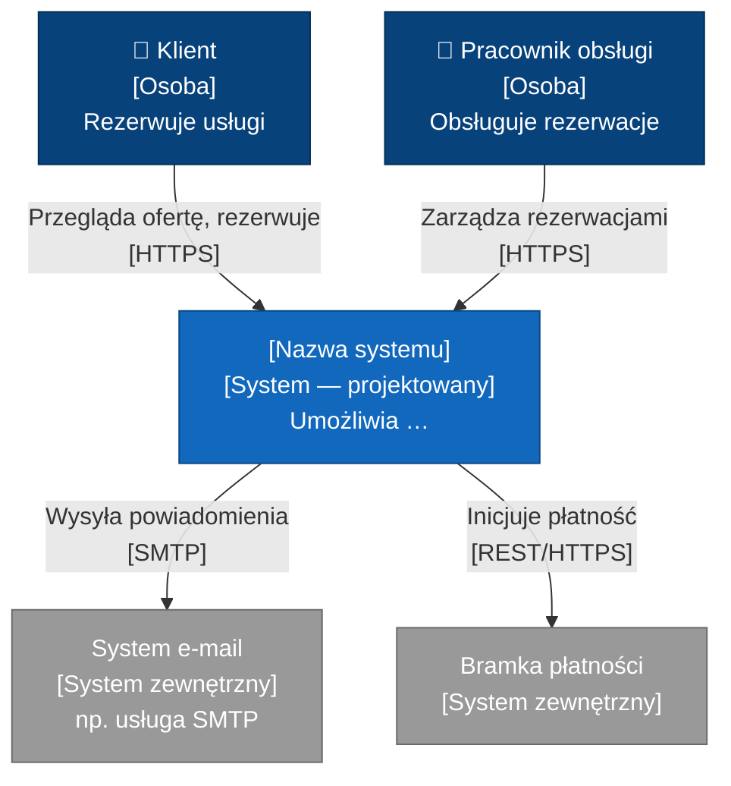
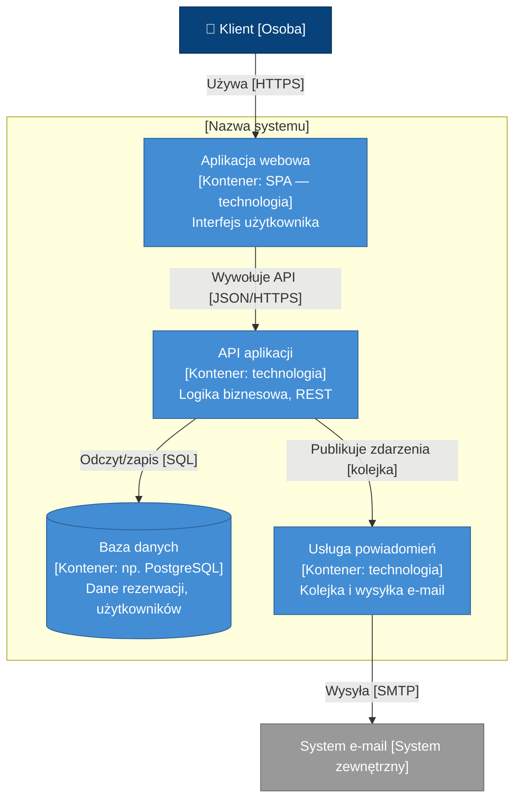

# 3. Architektura Systemu i Decyzje Technologiczne

<!--
Właściciel wiodący: Architekt Systemu. Termin: v0.9 (48 h przed Zjazdem 3); szkic na Zjeździe 2.
Minimum: C4 Context + C4 Container; stos technologiczny z uzasadnieniem; ≥ 3 ADR (w docs/adr/).
Typowe błędy: brak opisów relacji (strzałka bez etykiety i protokołu); "kontener" mylony z Dockerem;
stos wybrany "bo znamy" bez odniesienia do NFR; ADR bez alternatyw; aktorzy inni niż w rozdz. 2.1.
C4 rysujemy w Mermaid jako flowchart (stabilne renderowanie na GitHubie); składnia C4Context jest eksperymentalna.
-->

## 3.1. Architektura wysokopoziomowa — C4 Context (system w otoczeniu)

**Opis:** [kto korzysta z systemu, z jakimi systemami zewnętrznymi się integruje i po co]

## 3.2. Architektura komponentowa — C4 Container

| Kontener | Odpowiedzialność | Technologia | Komunikacja |
|---|---|---|---|
| [Aplikacja webowa] | [ ] | [ ] | [ ] |
| [API aplikacji] | [ ] | [ ] | [ ] |
| [Baza danych] | [ ] | [ ] | [ ] |
| [ ] | [ ] | [ ] | [ ] |

## 3.3. Stos technologiczny i uzasadnienie wyboru

| Warstwa | Wybór | Uzasadnienie (odwołanie do NFR / ograniczeń) | Rozważane alternatywy | ADR |
|---|---|---|---|---|
| Frontend | [ ] | [ ] | [ ] | ADR-001 |
| Backend / API | [ ] | [ ] | [ ] | ADR-001 |
| Baza danych | [ ] | [np. NFR-05 spójność transakcji → relacyjna] | [ ] | ADR-002 |
| Uwierzytelnianie | [ ] | [ ] | [ ] | ADR-003 |
| Protokoły / formaty | [REST + JSON, OpenAPI 3] | [ ] | [GraphQL, gRPC] | |
| Hosting / uruchomienie | [np. kontenery Docker w chmurze UE] | [ ] | [ ] | |

## 3.4. Kluczowe decyzje architektoniczne (ADR)

Pełna treść decyzji w katalogu [`adr/`](adr/README.md). Zestawienie:

| ID | Decyzja | Status | Powiązane wymagania |
|---|---|---|---|
| ADR-001 <!-- zamień na link, np. [ADR-001](adr/ADR-001-styl-architektury.md) --> | [np. Monolit modularny zamiast mikroserwisów] | przyjęta | [NFR-05, OGR-01] |
| ADR-002 | [ ] | [ ] | [ ] |
| ADR-003 | [ ] | [ ] | [ ] |
