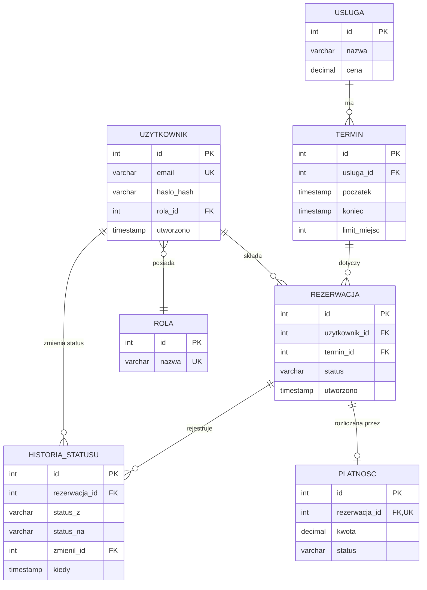
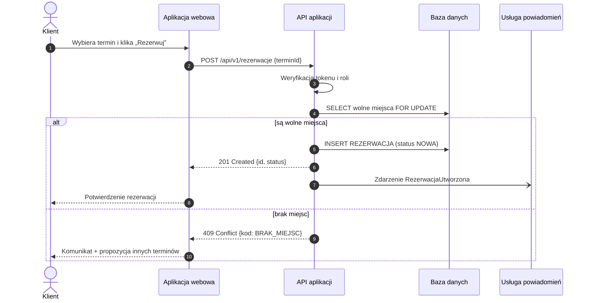
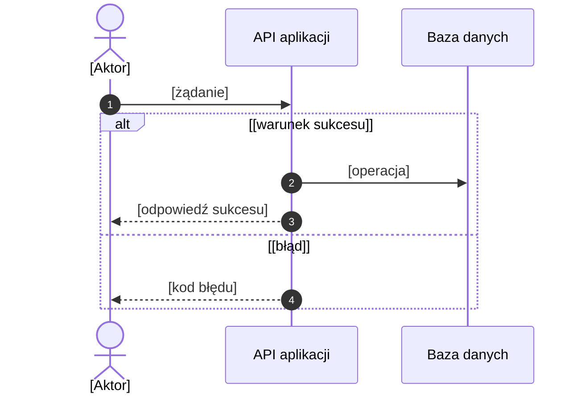

# 4. Szczegółowy Projekt Danych i Logiki

<!--
Właściciel wiodący: Projektant Danych (ERD, słownik) + Architekt (sekwencje, API). Termin: v0.9.
Minimum: ERD ≥ 6 encji z kluczami i licznościami + słownik danych; ≥ 2 diagramy sekwencji kluczowych procesów
z fragmentem alt dla błędu; API dla wszystkich FR "Must" (metoda, ścieżka, rola, żądanie/odpowiedź, kody błędów).
Typowe błędy: relacja N:M bez tabeli asocjacyjnej; brak typów i ograniczeń w słowniku; inne nazwy encji w ERD i w API;
sekwencja bez odpowiedzi błędu; endpointy z czasownikami (/getReservations) zamiast zasobów (GET /reservations).
-->

## 4.1. Logiczny i fizyczny model bazy danych

### Diagram ERD



<!-- Liczności Mermaid: ||--|| (1:1), ||--o{ (1:0..N), ||--|{ (1:1..N), }o--o{ (N:M — w modelu fizycznym rozbij tabelą asocjacyjną). -->

### Słownik danych

#### Encja: [REZERWACJA]

**Opis:** [czym jest encja w języku dziedziny]

| Atrybut | Typ | Wymagany | Ograniczenia / reguły | Opis |
|---|---|---|---|---|
| id | INTEGER | tak | PK, autoinkrementacja | Identyfikator |
| uzytkownik_id | INTEGER | tak | FK → UZYTKOWNIK.id | Kto zarezerwował |
| termin_id | INTEGER | tak | FK → TERMIN.id | |
| status | VARCHAR(20) | tak | {NOWA, ZATWIERDZONA, ANULOWANA, ZREALIZOWANA} | Bieżący status |
| utworzono | TIMESTAMP | tak | domyślnie: czas bieżący | |

**Reguły integralności:** [np. liczba rezerwacji ZATWIERDZONA dla terminu ≤ TERMIN.limit_miejsc; jeden użytkownik — jedna aktywna rezerwacja na termin]

#### Encja: [ … ]

| Atrybut | Typ | Wymagany | Ograniczenia / reguły | Opis |
|---|---|---|---|---|
| | | | | |

## 4.2. Projekt przepływów danych — diagramy sekwencji

### SEQ-01: [Nazwa procesu, np. Utworzenie rezerwacji] (FR-01, FR-03; PROC-01)



**Opis:** [kluczowe decyzje: blokada wiersza, asynchroniczne powiadomienie itp.]

### SEQ-02: [Nazwa procesu] ([FR-…])



## 4.3. Specyfikacja interfejsów komunikacyjnych (API)

**Konwencje:** prefiks `/api/v1`, format JSON (UTF-8), uwierzytelnianie nagłówkiem `Authorization: Bearer <token>`, daty w ISO 8601 (UTC), błędy w formacie:

```json
{ "kod": "BRAK_MIEJSC", "komunikat": "Wybrany termin nie ma wolnych miejsc.", "szczegoly": {} }
```

### Zestawienie endpointów

| ID | Metoda | Ścieżka | Opis | Rola | FR | Kody odpowiedzi |
|---|---|---|---|---|---|---|
| API-01 | GET | `/api/v1/terminy?uslugaId={id}&od={data}` | Lista dostępnych terminów | Gość, Klient | FR-0x | 200, 400 |
| API-02 | POST | `/api/v1/rezerwacje` | Utworzenie rezerwacji | Klient | FR-01 | 201, 400, 401, 409 |
| API-03 | GET | `/api/v1/rezerwacje/{id}` | Szczegóły rezerwacji | Klient (własne), Pracownik | FR-0x | 200, 403, 404 |
| API-04 | PATCH | `/api/v1/rezerwacje/{id}` | Zmiana statusu | Pracownik | FR-0x | 200, 400, 403, 409 |
| API-05 | [ ] | [ ] | [ ] | [ ] | [ ] | [ ] |

### Szczegóły wybranych endpointów

#### API-02: `POST /api/v1/rezerwacje`

**Żądanie:**

```json
{ "terminId": 125, "uwagi": "Proszę o miejsce przy oknie" }
```

**Odpowiedź `201 Created`:**

```json
{ "id": 9876, "terminId": 125, "status": "NOWA", "utworzono": "2026-11-14T09:30:00Z" }
```

**Błędy:** `400` niepoprawne dane · `401` brak/nieważny token · `409` `BRAK_MIEJSC` lub `DUPLIKAT_REZERWACJI`
